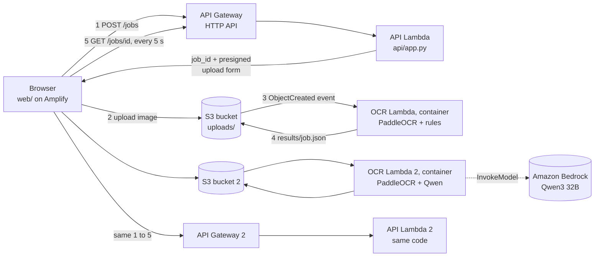

# Bill Extractor

Upload a photo or scan of an Indian electricity bill (KESCO / UPPCL layout) and get **69 structured
fields** back: consumer details, billing dates, amounts, the charges table, taxes, and so on.
The result has the same layout as [samples/Sample_Output.xlsx](samples/Sample_Output.xlsx).

There are **two extraction pipelines**, and the web page runs both on the same upload so you can compare them:

| | Pipeline 1: rules | Pipeline 2: LLM |
|---|---|---|
| Reading the image | PaddleOCR (CPU) | the same PaddleOCR step |
| Choosing the 69 fields | hand-written position + label rules ([billocr/extract.py](billocr/extract.py)) | **Qwen3 32B** on Amazon Bedrock ([pipeline2/qwen_extract.py](pipeline2/qwen_extract.py)) |
| Works on | only this bill layout | any layout in principle; tuned on this one |
| Cost per bill | Lambda time only | Lambda time + ~$0.0035 of Bedrock tokens |

Everything runs on AWS serverless services: no servers, no VPC, nothing to pay for when idle except
about $0.25/month per stored container image.

---

## Contents

1. [How it works](#1-how-it-works)
2. [Repository layout](#2-repository-layout)
3. [Run it locally](#3-run-it-locally) (no AWS needed)
4. [Deploy it to AWS](#4-deploy-it-to-aws)
5. [Things that will bite you](#5-things-that-will-bite-you)
6. [Cost, security and data retention](#6-cost-security-and-data-retention)
7. [Changing things](#7-changing-things)
8. [Tear down](#8-tear-down)

---

## 1. How it works



**One pipeline, step by step** (both pipelines work the same way; each has its own stack):

1. **`POST /jobs`** `{"content_type": "image/png"}` → the API Lambda creates a random `job_id`
   and returns a **presigned S3 upload form**, valid for 10 minutes, for exactly one key
   `uploads/<job_id>.png`, PNG/JPEG only, max 10 MB.
2. The browser **uploads the image directly to S3**. The file never passes through API Gateway.
3. S3 **triggers the OCR Lambda**. It scales the image to 596 px wide (the rules use pixel positions
   measured at that width), runs PaddleOCR, then extracts the fields.
4. The OCR Lambda writes **`results/<job_id>.json`**: `{"status": "done", "result": {...}}` or
   `{"status": "error", "error": "..."}`.
5. The page polls **`GET /jobs/<job_id>`** every 5 s until the status is not `processing`.

**Why asynchronous?** OCR takes 2–5 minutes on Lambda, and an API Gateway request can last at
most 30 seconds. So the work is started by the upload, and the result is fetched later.

**Credentials: there are no API keys.** Everything uses AWS IAM:

| What | Used for | Where it comes from |
|---|---|---|
| Your IAM user's access key (your AWS profile) | **Deploying only** | your machine's `~/.aws/credentials`; never in the app |
| Lambda execution roles | S3 read/write; Bedrock (Qwen models only) | created by CloudFormation from the `Policies:` in the templates; AWS rotates the temporary keys |
| Presigned upload form | uploading one file | signed by the API Lambda's role |
| `job_id` (32 random hex chars) | fetching your result | `uuid4()` |

The APIs are **public**. CORS only stops *other websites* from calling them in a browser. Abuse is
limited by API throttling (10 req/s), a **"max 2 bills processing at once"** guard per pipeline
(`MAX_ACTIVE_JOBS` in [api/app.py](api/app.py)), the 10 MB limit, and data expiring after one day.

### How pipeline 2 asks Qwen

[pipeline2/qwen_extract.py](pipeline2/qwen_extract.py):

- The OCR boxes are rendered as **layout-preserving text**, like `pdftotext -layout`. Table
  columns line up, and an empty cell is visible as blank space. Raw coordinates gave clearly
  worse results.
- The prompt lists the 69 fields with their formats, plus a few rules:
  - copy text exactly
  - never mix the two side-by-side tables
  - a blank cell is not 0
- **3 calls run in parallel, and each field takes the majority answer** (`QWEN_VOTES`). Bedrock
  answers vary between calls even at temperature 0; voting removes most of that.
- Token usage comes from the Bedrock Converse API, is summed over the calls, and is shown on the page.

Measured on the sample bill: **68.6 of 69 fields** equal to `Sample_Output.xlsx` on average (10
runs). The occasional miss is "Demand Charges - Subsidy" printed as `0.00` and read as blank.

---

## 2. Repository layout

```
billocr/               shared OCR + rules code (used by pipeline 1, CLI scripts, tests)
  ocr.py               PaddleOCR wrapper, image scaling to 596 px, CSV read/write
  extract.py           the 69 fields (ORDER), rules per field, validation checks, JSON output
  excel.py             writes the Sample_Output.xlsx layout
pipeline2/
  qwen_extract.py      OCR -> layout text -> Qwen3 32B prompt -> vote -> same JSON shape as pipeline 1
api/app.py             API Lambda (used by BOTH stacks, unchanged between them)
container/ocr/         pipeline 1 OCR Lambda: Dockerfile + handler
container/qwen/        pipeline 2 OCR Lambda: Dockerfile + handler
template.yaml          SAM template, stack bill-ocr-demo       (pipeline 1)
template-qwen.yaml     SAM template, stack bill-ocr-demo-qwen  (pipeline 2)
samconfig.example.toml SAM settings for both stacks -> copy to samconfig.toml
web/                   static page (plain HTML/CSS/JS, no build step)
deploy/                IAM policies the deploying user needs + deploy notes
scripts/
  copy_models.py       copies the OCR models into ./models for the Docker build
  deploy_web.py        uploads web/ to Amplify Hosting with the API URLs in config.js
  smoke_test.py        end-to-end test of a deployed API with the sample bill
  eval_qwen.py         runs Qwen on the saved OCR result and scores it against Sample_Output.xlsx
  invoke_local.py      calls an OCR container running locally under the Lambda emulator
  mock_api.py          local stand-in for both backends, to use web/ without AWS
  aws_env.py           AWS session from env vars, with an account safety check
samples/               the sample bill, the expected output, saved OCR results (test fixtures)
tests/                 pytest: fast tests by default, `-m slow` runs real OCR
run_ocr.py             CLI step 1: image -> output/ocr_result.csv
extract_bill.py        CLI step 2: ocr_result.csv -> output/bill_output.xlsx
requirements.txt       pinned runtime deps (also installed into the Lambda images)
requirements-dev.txt   pytest, boto3, playwright
requirements-lock.txt  reference only: full freeze of the original Windows environment
```

Git-ignored, created locally: `models/`, `output/`, `.aws-sam/`, `.tools/`, `samconfig.toml`,
your virtualenv.

---

## 3. Run it locally

### Prerequisites

- **Python 3.11** (tested with 3.11.9). PaddlePaddle 3.4.0 has no Python 3.12+ wheels here.
- **Git**
- For the Docker and AWS parts: **Docker Desktop**, **AWS CLI v2**, **SAM CLI** (see step 4.0)

Developed and tested on Windows 11. Linux and macOS (x86_64) should work; the commands below show both shells.

### Install

```bash
python -m venv .venv
# Windows PowerShell:  .venv\Scripts\Activate.ps1     macOS/Linux:  source .venv/bin/activate

# paddlepaddle 3.4.0 is only on Paddle's own package index, everything else comes from PyPI
pip install -r requirements.txt -r requirements-dev.txt \
    --extra-index-url https://www.paddlepaddle.org.cn/packages/stable/cpu/

# macOS/Linux only (Windows uses the installed Edge): a headless browser for the UI tests
python -m playwright install chromium
```

### Test

```bash
pytest                # ~50 fast tests, ~20 s: rules, Excel, both Lambdas (fake S3 / Bedrock), web UI
pytest -m slow        # real PaddleOCR on the sample bill, ~5-10 min; downloads the models first time
```

The OCR models (~135 MB) download into `~/.paddlex`. To put them somewhere else, set
`PADDLE_PDX_CACHE_HOME` (for example `D:\paddle-models`) **before** the first run.

### Use it

```bash
python run_ocr.py         # samples/electricity_bill_sample.png -> output/ocr_result.csv (~4 min on CPU)
python extract_bill.py    # -> output/bill_output.xlsx (Sheet1 = 69 fields, Checks = validation)

python scripts/mock_api.py           # web UI with canned results for both pipelines
python scripts/mock_api.py --single  # only pipeline 1
python scripts/mock_api.py --real    # real OCR (+ real Qwen if your AWS credentials allow Bedrock)
# then open http://localhost:8765
```

### Test an OCR Lambda image locally (optional)

```bash
python scripts/copy_models.py                       # models -> ./models (needed by both Dockerfiles)
docker build -f container/ocr/Dockerfile -t ocrfunction:v1 .
# AWS Lambda Runtime Interface Emulator, kept out of the image:
mkdir -p .tools && curl -L -o .tools/aws-lambda-rie \
  https://github.com/aws/aws-lambda-runtime-interface-emulator/releases/download/v1.37/aws-lambda-rie
docker run --rm -p 9000:8080 --read-only --tmpfs /tmp:size=512m --cpus=1.7 --memory=3008m \
  -e AWS_LAMBDA_FUNCTION_TIMEOUT=900 -v "$PWD/.tools:/aws-lambda" \
  --entrypoint /aws-lambda/aws-lambda-rie ocrfunction:v1 python -m awslambdaric app.handler
python scripts/invoke_local.py                      # in another terminal; compares with Sample_Output.xlsx
```

`--cpus=1.7 --memory=3008m` matches the deployed Lambda, so expect about 10 minutes on a laptop.
`AWS_LAMBDA_FUNCTION_TIMEOUT=900` matters: the emulator's default 300 s cuts the run off and returns nothing.

---

## 4. Deploy it to AWS

All resources are named `bill-ocr-demo*` / `billocrdemo*`, region **ap-southeast-2**. Allow about an
hour the first time; the image builds and uploads are the slow part.

### 4.0 Tools

```bash
# SAM CLI in its own venv (keeps it out of the app's environment); or use AWS's installer
python -m venv .tools/sam-env
.tools/sam-env/Scripts/pip install aws-sam-cli==1.166.2      # macOS/Linux: .tools/sam-env/bin/pip
# then use .tools/sam-env/Scripts/sam (or bin/sam) wherever this README says `sam`
```

### 4.1 Permissions (account admin, once)

The deploying IAM user needs two policies. Replace `ACCOUNT_ID` first:

```bash
sed 's/ACCOUNT_ID/123456789012/g' deploy/iam-deployer-policy.json      > /tmp/p1.json
sed 's/ACCOUNT_ID/123456789012/g' deploy/iam-deployer-policy-qwen.json > /tmp/p2.json
```

- `iam-deployer-policy.json` covers pipeline 1 and the shared pieces: CloudFormation, S3, ECR, Lambda,
  IAM roles named `bill-ocr-demo-*`, API Gateway and logs. Amplify rights are **not** included; the
  user also needs `amplify:*` on its apps.
- `iam-deployer-policy-qwen.json` covers pipeline 2's stack and bucket, and Bedrock: list models, and
  invoke **Qwen models only**.
- In the Bedrock console (ap-southeast-2) check that **Qwen3 32B (dense)**, `qwen.qwen3-32b-v1:0`, is
  available under *Model access*.

### 4.2 Your environment

```bash
export AWS_PROFILE=your-profile          # PowerShell: $env:AWS_PROFILE = "your-profile"
export AWS_REGION=ap-southeast-2
export BILL_AWS_ACCOUNT=123456789012     # scripts refuse to run against any other account
aws sts get-caller-identity              # must print that account

cp samconfig.example.toml samconfig.toml # then replace YOUR_AWS_PROFILE and ACCOUNT_ID inside
```

### 4.3 ECR repositories (once)

SAM would normally create these in an extra "companion" stack, which the scoped policy does not
allow, so create them directly. Each keeps only its 2 newest images:

```bash
for r in billocrdemo-ocr billocrdemo-qwen; do
  aws ecr create-repository --repository-name $r --encryption-configuration encryptionType=AES256
  aws ecr put-lifecycle-policy --repository-name $r --lifecycle-policy-text \
    '{"rules":[{"rulePriority":1,"selection":{"tagStatus":"any","countType":"imageCountMoreThan","countNumber":2},"action":{"type":"expire"}}]}'
done
```

### 4.4 Models for the images

```bash
python run_ocr.py                 # once, downloads the models (skip if pytest -m slow already did)
python scripts/copy_models.py     # -> ./models, baked into both images (nothing is downloaded on Lambda)
```

### 4.5 Pipeline 1

```bash
sam build                         # ~15-20 min the first time (Docker image, 2.6 GB)
sam deploy                        # pushes the image, shows the change set, asks y/N
```

Note the **`ApiUrl`** output. Check it end to end (~5 min):
`python scripts/smoke_test.py <ApiUrl>`, which should report 0 fields differing from Sample_Output.xlsx.

### 4.6 Pipeline 2 (optional)

```bash
sam build --config-env qwen
sam deploy --config-env qwen
python scripts/smoke_test.py <ApiUrl of bill-ocr-demo-qwen>   # prints token usage; ~0-1 fields differ
python scripts/eval_qwen.py --runs 3                          # Qwen only on the saved OCR (cheap, no deploy)
```

### 4.7 Website

```bash
python scripts/deploy_web.py <pipeline 1 ApiUrl> --qwen-api <pipeline 2 ApiUrl>
# first run creates the Amplify app "bill-ocr-demo" and prints its id and https://main.<id>.amplifyapp.com
# later runs: python scripts/deploy_web.py <api1> <amplify app id> --qwen-api <api2>
```

Leave out `--qwen-api` for a pipeline 1-only page.

Then **lock CORS to the site**: in `samconfig.toml` set `AllowedOrigin=https://main.<id>.amplifyapp.com`
in both `parameter_overrides`, and run `sam deploy` plus `sam deploy --config-env qwen` again. The
change set modifies the bucket and the API. The Lambda functions and roles also appear as
"Modify / Dynamic", only because they reference those resources; nothing is replaced.

---

## 5. Things that will bite you

These are all real problems hit while building this. The fixes are already in the code.

| Symptom | Cause | What we did |
|---|---|---|
| Stack rolls back: `MemorySize ... less than or equal to 3008` | New AWS accounts cap Lambda memory at 3008 MB | `OcrMemoryMB=3008` (~1.7 vCPU, 2–5 min per bill). Ask AWS Support to raise the quota, then 10240 MB gives 6 vCPU, ~1–3 min. |
| Rollback: `UnreservedConcurrentExecution below its minimum value of [10]` | Account concurrency limit is 10 and none can be reserved | No `ReservedConcurrentExecutions`; the API answers 429 "try again" while 2 jobs run. |
| `not authorized ... CompanionStack` | SAM's automatic ECR repo stack is outside the scoped policy | Create the ECR repos yourself (4.3) and list them in `image_repositories`. |
| `not authorized ... apigateway:TagResource` | SAM tags the HTTP API stage | The policy grants `apigateway:*` on `/apis*` and `/tags/*`. |
| Docker build fails at `apt-get` with `Failed to fetch ... Remote end closed connection` | Debian mirror hiccup | Run `sam build` again. |
| `Unable to upload artifact ... referenced by ImageUri` | ECR push interrupted (2.6 GB) | Run `sam deploy` again; layers already uploaded are skipped. |
| Local emulator returns an empty response | Emulator default timeout 300 s | `-e AWS_LAMBDA_FUNCTION_TIMEOUT=900` (section 3). |
| `paddlepaddle==3.4.0` not found | Not on PyPI | `--extra-index-url https://www.paddlepaddle.org.cn/packages/stable/cpu/` |
| AWS Lambda Python 3.11 base image can't install numpy/shapely | Amazon Linux 2 has glibc 2.26; the wheels need 2.27/2.28 | The Dockerfiles use `python:3.11.9-slim-bookworm` + `awslambdaric` (an AWS-supported pattern). |
| A rule-based field is empty on a new bill | Rules use pixel positions of *this* layout | See section 7. |

---

## 6. Cost, security and data retention

**Cost.** Idle: ~$0.25/month per ECR image. Per bill:
- pipeline 1: ~$0.01–0.03 of Lambda time
- pipeline 2: the same, plus ~$0.0035 of Qwen tokens (3 calls × ~3.6K input / ~1K output)

Most Lambda time fits in the monthly free tier for demo volumes.

**Data retention.**
- Uploads and results are deleted by an S3 lifecycle rule after 1 day.
- The buckets are private and encrypted.
- Logs (job id, status, timing, token counts; no bill content) are kept for 7 days.
- Nothing else is stored.

**Never commit:** `samconfig.toml`, `.env*`, AWS credentials, `.aws/`. They are in `.gitignore`.
Use only fake/sample bills.

---

## 7. Changing things

- **Another bill layout (pipeline 1):** add a rule set like the one in `billocr/extract.py`. Labels plus
  pixel regions are measured on a 596 px-wide image; the OCR engine stays the same. The field list
  is `ORDER`. Update `samples/` with a new expected output, and the tests follow.
- **The Qwen prompt:** edit `build_prompt()` in `pipeline2/qwen_extract.py`, then measure:
  `python scripts/eval_qwen.py --runs 5`. Judge by min/mean over several runs, never one run.
  Settings (env vars on the Lambda): `QWEN_MODEL_ID`, `BEDROCK_REGION`, `QWEN_VOTES`.
- **Another model:** set the template parameter `QwenModelId`. The Lambda role allows `qwen.*` models
  only; widen `template-qwen.yaml` and the deploy policy for others.
- After any change: run `pytest`, then `sam build && sam deploy` for the stack you changed. The two
  stacks are independent; deploying one never touches the other.

---

## 8. Tear down

Removes everything and stops all cost (bash; delete pipeline 2 first if you keep pipeline 1):

```bash
A=$BILL_AWS_ACCOUNT
aws amplify delete-app --app-id <amplify app id>
aws s3 rm s3://bill-ocr-demo-qwen-bills-$A --recursive && sam delete --stack-name bill-ocr-demo-qwen
aws s3 rm s3://bill-ocr-demo-bills-$A --recursive      && sam delete --stack-name bill-ocr-demo
aws ecr delete-repository --repository-name billocrdemo-qwen --force
aws ecr delete-repository --repository-name billocrdemo-ocr --force
```
